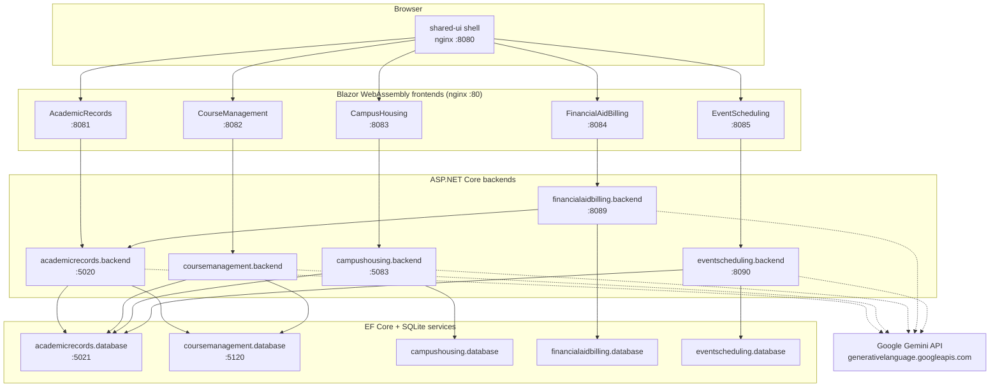
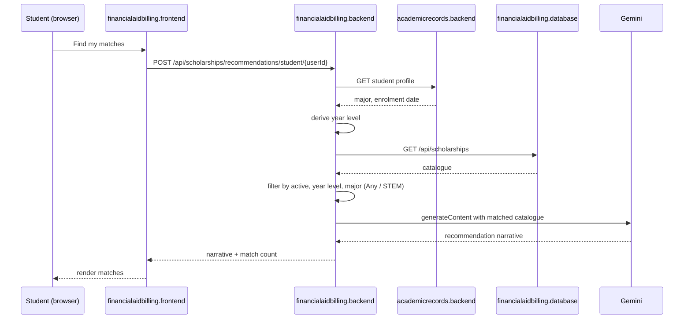

# System Architecture

CampusPulseAI is a .NET 10 microservice solution delivering five campus-services domains
behind a shared Blazor component library, orchestrated with Docker Compose and validated
by a shared agentic AI loop.

- **SDK:** .NET 10.0.400 (`global.json`, `rollForward: latestPatch`)
- **Packages:** centrally pinned in `Directory.Packages.props` — ASP.NET Core 10.0.9,
  EF Core 10.0.9 (Sqlite + Design), NUnit 4.3.2, NUnit3TestAdapter 5.0.0,
  Microsoft.NET.Test.Sdk 17.14.0, QuestPDF 2024.12.3, Microsoft.OpenApi 2.7.5
- **Projects:** 21 across five student domains, three AI service scaffolds, one shared
  component library, plus `docker-compose.dcproj`

## Layering

Every student domain follows the same four-project shape:

| Layer | Responsibility |
|---|---|
| Frontend | Blazor WebAssembly, published to static files and served by nginx on port 80. |
| Backend | ASP.NET Core minimal APIs. Orchestrates the database service, peer services and Gemini. No direct database access. |
| Database | ASP.NET Core service owning an EF Core `DbContext` over SQLite. The only writer to its own data. |
| Tests | NUnit coverage of validation rules and seeded data. |

The database-as-a-service split is the defining decision: a backend never opens a SQLite
file. It calls its database service over HTTP using a named `HttpClient`, which keeps each
domain's storage private and makes cross-service reads explicit.

## Container diagram

Ports shown are host ports declared in `docker-compose.yml`. Services without a port are
reachable only by service name on the Compose network. `docker-compose.override.yml`
publishes additional ports for local debugging.

## Service inventory

| Owner | Domain | Backend | Database | Frontend |
|---|---|---|---|---|
| student-1 | Academic Records | 5020 | 5021 | 8081 |
| student-2 | Course Management | not published | 5120 | 8082 |
| student-3 | Campus Housing | 5083 | not published | 8083 |
| student-4 | Financial Aid & Billing | 8089 | not published | 8084 |
| student-5 | Event Scheduling | 8090 | not published | 8085 |
| shared | Static shell | — | — | 8080 |

All .NET containers listen internally on `8080` via `ASPNETCORE_HTTP_PORTS`. Frontends are
served by nginx on `80`.

## Integration map

Cross-service discovery is entirely environment-variable driven. Each backend resolves
peers from `Services__*` keys, falling back to a Compose service name.

| Consumer | Depends on | Configuration key |
|---|---|---|
| academicrecords.backend | academicrecords.database | `Services__AcademicRecordsDatabase` |
| academicrecords.backend | coursemanagement.database | `Services__CourseManagementDatabase` |
| coursemanagement.backend | academicrecords.database | `Services__AcademicRecordsDatabase` |
| coursemanagement.backend | coursemanagement.database | `Services__CourseManagementDatabase` |
| campushousing.backend | campushousing.database | `Services__CampusHousingDatabase` |
| campushousing.backend | academicrecords.database | `Services__AcademicRecordsDatabase` |
| campushousing.database | academicrecords.database | `Services__AcademicRecordsDatabase` |
| financialaidbilling.backend | financialaidbilling.database | `Services__InvoiceDatabase` |
| financialaidbilling.backend | **academicrecords.backend** | `Services__AcademicRecordsBackend` |
| eventscheduling.backend | eventscheduling.database | `Services__EventDatabase` |
| eventscheduling.backend | academicrecords.database | `Services__AcademicRecordsDatabase` |

Academic Records is the hub: every other domain reads student identity from it. Financial
Aid & Billing is the only service that integrates at the **backend** tier rather than the
database tier, because it consumes the composed student profile rather than raw rows.

`GEMINI_API_KEY` is passed to all five backends as `${GEMINI_API_KEY:-}`, so an unset key
leaves AI features disabled without breaking startup.

## Request flow — AI scholarship recommendation

The deepest cross-service path in the solution:

Failure at the Gemini or Academic Records step surfaces as `503`; invoices, payments and
the scholarship catalogue remain usable.

## Shared frontend

`shared/frontend/CampusPulse.Shared.Components` (targeting `net10.0`) provides the common
UI vocabulary:

| Component | Purpose |
|---|---|
| `CampusShell` | Page chrome, header, user identity display. |
| `CampusNavBar` | Cross-service navigation. |
| `CampusMetricCard` | Dashboard metric tiles. |
| `CampusSectionTabs` | Tabbed section switching. |

Supporting assets live in `shared/frontend/css/theme.css`, `shared/frontend/js/common.js`
and `shared/frontend/assets/`. The `shared-ui` service publishes this directory directly
through `nginx:alpine` as the landing shell on port 8080.

Currently only the **student-4** and **student-5** frontends reference the component
library as a project reference; students 1, 2 and 3 reproduce the styling in their own
frontends. See "Known gaps".

## Persistence

Each database service writes a single SQLite file under `/app/data`:

| Service | File | Named volume |
|---|---|---|
| academicrecords.database | `academic-records.db` | none |
| coursemanagement.database | `course-management.db` | `coursemanagement-data` |
| campushousing.database | `campus-housing.db` | `campushousing-data` |
| financialaidbilling.database | `financial-aid-billing.db` | none |
| eventscheduling.database | `event-scheduling.db` | none |

Course Management additionally enables `Foreign Keys=True` on its connection string and
stores uploaded syllabi under `SyllabusStorage__RootPath=/app/data/syllabi`.

## Startup ordering and health

`depends_on` wires the graph, but only two services expose a healthcheck
(`academicrecords.database` and `campushousing.database`, both HTTP `GET /health` at 5s
intervals, 3s timeout, 12 retries). Only `campushousing.backend` waits on
`service_healthy`; every other dependency waits merely for container start, which is why
services implement their own retry logic — Financial Aid & Billing, for example, retries
read requests to its database 30 times at one-second intervals.

## Quality gates

Seven workflows in `.github/workflows/`:

| Workflow | Scope |
|---|---|
| `student-1-ci.yml` … `student-5-ci.yml` | Per-domain restore, build, test, container build and smoke test. Each uses `dorny/paths-filter` so it only runs when its own `student-N/**` paths change, or on `workflow_dispatch`. |
| `integration-ci.yml` | Builds the whole solution, runs `docker compose up --detach --build`, then polls until every container reaches running state (30 attempts × 2s) before tearing down. |
| `cloud-deployment.yml` | Empty placeholder — not implemented. |

The agentic loop at `scripts/agentic-loop/agentic_loop.py` runs the same deterministic
gates (`dotnet restore`, `build`, `test`, `docker compose config --quiet`, HTTP smoke
tests) as its Observe stage. It never auto-applies changes: a patch is applied only with
`--apply`, an `--approved-patch` file and human `--approval-text`. Evidence is written as
JSON to `docs/release-0/agentic-loop-evidence/`. See
[the Release 0 report section](../release-0/agentic-loop-technical-report-section.md).

## Known gaps

Recorded honestly so they can be prioritised rather than discovered at marking.

| Gap | Detail | Impact |
|---|---|---|
| AI service scaffolds | `mcpserver`, `multiagentserver` and `ragserver` build and run but contain only the default `WeatherForecast` scaffold. No student service references them and no environment variable points at them. `ai-services/ai-mode/` is empty. | Present in the topology but contribute nothing in Release 0. AI features currently call Gemini directly from each backend. |
| Volume coverage | Only Course Management and Campus Housing declare named volumes. Academic Records, Financial Aid & Billing and Event Scheduling lose their SQLite file on container recreation. | Fails the persistence NFR for three domains. |
| Healthcheck coverage | Two of five databases have healthchecks; no backend or frontend has one. | `depends_on` cannot guarantee readiness; services compensate with retries. |
| Shared component adoption | Only students 4 and 5 reference `CampusPulse.Shared.Components`. | Visual and navigational consistency is convention rather than enforced. |
| Empty configuration | `shared/configuration/nginx.conf` is an empty file; `.env.template` contains only `GEMINI_API_KEY=`. | Frontend Dockerfiles carry their own nginx config; the template understates the variables actually required. |
| Deployment automation | `cloud-deployment.yml` is empty. | No cloud deployment path in Release 0. |
| Authorisation | Backends register `AddAuthorization()` without policies and permit any CORS origin. | Endpoints are publicly callable within the Compose network and from any browser origin. |

## Conventions

Documentation uses Australian English. Code identifiers retain their framework-native
spelling (`Color`, `InitializeAsync`, `AddAuthorization`) and are never Australianised.
