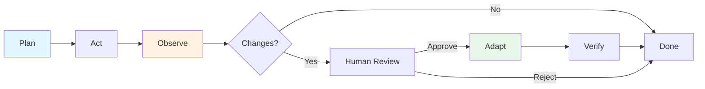

# Agentic AI Loop — Technical Report Section

## 1. Agentic AI Workflow

### 1.1 Overview

CampusPulseAI implements a shared Agentic AI loop that follows the required **Plan → Act → Observe → Adapt** workflow. The loop is implemented in Python at `scripts/agentic-loop/agentic_loop.py` and validates the entire integrated solution rather than a single student's work.

### 1.2 Workflow Stages

| Stage | Activity | Output |
|---|---|---|
| **Plan** | An AI agent reads the approved project context and produces a small, testable validation plan. | Plan text: what to check, why it matters, and expected outcomes. |
| **Act** | An AI agent proposes concrete changes or confirms that no changes are needed based on the plan. | Implementation proposal or a statement that the existing solution satisfies the goal. |
| **Observe** | Deterministic checks (`dotnet restore`, `dotnet build`, `dotnet test`, `docker compose config`, HTTP smoke tests) run, and an independent AI agent reviews the proposal against the evidence. | Check results and a review verdict. |
| **Adapt** | A human decides whether to apply a patch. The loop never auto-applies changes. | Approved patch + human approval text, or a decision that no adaptation is required. |
| **Verify** | If a patch is applied, the deterministic checks run again to confirm the change did not break anything. | Updated check results. |

### 1.3 Workflow Diagram



### 1.4 Shared Scope

The loop validates the following integrated components:

- `student-1` / AcademicRecords
- `student-2` / CourseManagement
- `student-3` / CampusHousing
- `student-4` / FinancialAidBilling
- `student-5` / EventScheduling
- `ai-services/` (MCP server, multi-agent server, RAG server)
- `shared/frontend` shared Blazor components
- Root-level `docker-compose.yml` and `Directory.Packages.props`

## 2. AI-Mode and Multi-Model Configuration

### 2.1 Models Used

Release 0 uses two approved Large Language Models to satisfy the multi-model workflow requirement:

| Stage | Provider | Model | Role |
|---|---|---|---|
| Plan | OpenRouter | `qwen/qwen3.8-27b` | Plans the validation and identifies risks. |
| Act | OpenRouter | `qwen/qwen3.8-27b` | Proposes implementation changes or confirms no change is needed. |
| Observe / Review | OpenRouter requested, Gemini used | `gemini-3.5-flash` | Independently reviews the Qwen proposal against deterministic evidence. The `gemini-` prefix routes the stage to Gemini automatically. |

### 2.2 Model Routing

The Python loop routes each stage independently. If a stage model name starts with `gemini-`, that stage is sent to the Google Gemini `generateContent` API; all other stages are sent to OpenRouter's OpenAI-compatible API. This allows the team to use Qwen for planning/implementation and Gemini as an independent reviewer.

### 2.3 Environment Configuration

Configuration is read from a `.env` file in the repository root (`.env` is ignored by Git):

```text
OPENROUTER_API_KEY=sk-or-v1-...
GEMINI_API_KEY=...
AGENTIC_PLAN_MODEL=qwen/qwen3.8-27b
AGENTIC_ACT_MODEL=qwen/qwen3.8-27b
AGENTIC_REVIEW_MODEL=gemini-3.5-flash
AGENTIC_PROVIDER=openrouter
GEMINI_MODEL=gemini-3.5-flash
```

A template is provided at `.env.template` so every team member can recreate the same configuration.

## 3. Deterministic Checks

The loop runs the following deterministic validation before and after any adaptation:

| Check | Purpose | Result in Latest Run |
|---|---|---|
| `git diff --check` | No whitespace errors in pending changes. | PASS |
| `dotnet restore CampusPulseAI.slnx` | All NuGet packages resolve. | PASS |
| `dotnet build CampusPulseAI.slnx` | Entire solution compiles. | PASS |
| `dotnet test CampusPulseAI.slnx` | All student test projects pass. | PASS (192 tests across 5 test assemblies) |
| `docker compose config --quiet` | Docker Compose file is valid. | PASS |
| Per-student HTTP smoke tests | Best-effort live service checks. | SKIPPED (`passed=false`, `skipped=true`; services not running locally) |

All required build, test, and Docker Compose validation passed. Live HTTP smoke tests are optional because the review-only loop does not start the containers.

## 4. Prompt Engineering and Context Management

### 4.1 Approved Context File

All AI stages are grounded by a single approved context file:

```text
docs/release-0/agentic-loop-context/campuspulseai-context.txt
```

The context file contains:

- A description of the existing solution architecture.
- The five student services and their ownership.
- A list of deterministic checks that already pass.
- Rules preventing the agents from inventing dependencies, endpoints, or services.

### 4.2 Prompt Structure

Each stage uses a structured prompt with the following elements:

1. **Role** — e.g., "You are a senior software architect."
2. **Goal** — e.g., "Review the CampusPulseAI solution against the provided context."
3. **Context** — the approved context file content.
4. **Deterministic evidence** — build/test/Docker results.
5. **Constraints** — do not invent dependencies, do not replace working files with invented content, target the shared scope.
6. **Output format** — explicit headings such as `Assessment`, `Recommended Changes`, and `Rationale`.

### 4.3 Example Prompt Artefacts

The prompt engineering artefacts are embedded in the agentic loop source and the context file:

- `scripts/agentic-loop/agentic_loop.py` — system prompts and user prompts for Plan, Act, and Review stages.
- `docs/release-0/agentic-loop-context/campuspulseai-context.txt` — approved context and constraints.
- Evidence JSON files — every prompt sent and every model response is recorded.

## 5. Agentic Loop Execution Record

### 5.1 Latest Evidence File

The most recent agentic loop run produced the following evidence file:

```text
docs/release-0/agentic-loop-evidence/campuspulseai-20260906T031821Z.json
```

### 5.2 Evidence Contents

The JSON evidence file records:

- Timestamp and run configuration.
- Requested and actual provider/model for each stage in `models`.
- Full prompts sent to each AI agent in `plan`, `act`, and `observe`.
- Raw AI outputs (plan, act/proposal, review verdict).
- Approved project context.
- Deterministic check results in `observe.checks` and `verify.checks`.
- Human approval text and applied patch targets in `adapt`.
- Branch and commit identifiers in `git`.
- Any errors that caused the run to fail.

> API keys are redacted and are never written to evidence files.

### 5.3 How to Re-run the Loop

Install dependencies once:

```powershell
pip install -r scripts\agentic-loop\requirements.txt
```

Run a review-only loop:

```powershell
python scripts\agentic-loop\agentic_loop.py `
    --context docs\release-0\agentic-loop-context\campuspulseai-context.txt
```

Run with a specific focus:

```powershell
python scripts\agentic-loop\agentic_loop.py `
    --context docs\release-0\agentic-loop-context\campuspulseai-context.txt `
    --focus architecture
```

Valid focuses: `implementation`, `database`, `architecture`, `devops`.

### 5.4 Human Approval for Adaptations

The loop does not auto-apply changes. To apply a patch after human review:

```powershell
python scripts\agentic-loop\agentic_loop.py `
    --context docs\release-0\agentic-loop-context\campuspulseai-context.txt `
    --approved-patch C:\path\to\approved-change.patch `
    --approval-text "Approved after reviewing the plan, proposal, and tests." `
    --apply
```

The script validates that the patch only targets files inside the repository, applies it with `git apply`, and reruns the deterministic checks.

## 6. Mapping to Marking Criteria

| Criteria | How this section addresses it |
|---|---|
| Agentic AI Workflow (2 pts) | Plan → Act → Observe → Adapt is implemented in Python, demonstrated via the latest evidence file, and documented here. |
| Prompt Engineering and Context Management (2 pts) | Approved context file, structured per-stage prompts, and recorded prompt/response artefacts in evidence JSON. |
| Technical Report (2 pts) | This section provides workflow evidence, deterministic check results, multi-model configuration, and reproducible run instructions. |
| Project Setup (2 pts) | Shared loop validates all microservices, Docker Compose, and shared infrastructure. |
| DevOps and GitHub Actions (2 pts) | Deterministic checks mirror the build/test validation performed by the CI/CD workflows. |
| Docker Compose Integration (2 pts) | `docker compose config --quiet` is part of the observe stage. |

## 7. Known Limitations

- Live HTTP smoke tests are skipped during review-only runs because the services are not started locally. They are intended for use when the Docker Compose stack is running.
- The loop requires a valid OpenRouter API key or a fallback `GEMINI_API_KEY` if the OpenRouter key hits its usage limit.
- The latest run concluded that no code adaptation was required because the existing implementation already satisfied the validation goal.
