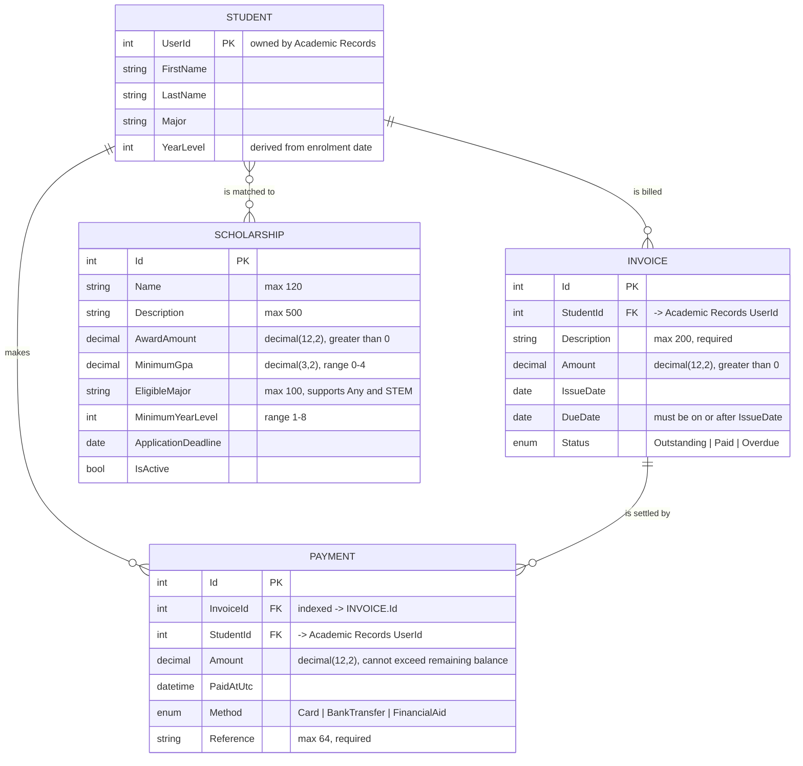

# Student 4 — Financial Aid & Billing (The Bursar)

**Owner:** Valin Kennedy · **Scrum role:** Developer · **Jira epic:** CAM-166

Invoicing, payments and scholarship management for CampusPulseAI, including a
Gemini-backed scholarship matching assistant.

## Architecture

| Layer | Project | Notes |
|---|---|---|
| Frontend | `student-4/frontend/FinancialAidBilling.Frontend` | Blazor WebAssembly, hosted behind nginx on port 8084. Uses the shared `CampusShell` layout. |
| Backend | `student-4/backend/FinancialAidBilling.Backend` | ASP.NET Core minimal APIs on port 8089. Orchestrates the database service, Academic Records and Gemini. |
| Database | `student-4/database/FinancialAidBilling.Database` | Owns the EF Core context and SQLite file at `/app/data/financial-aid-billing.db`. Not published to the host. |
| Tests | `student-4/tests/FinancialAidBilling.Tests` | NUnit coverage of validation rules and seed data. |

The backend never touches SQLite directly; it calls the database service over HTTP
using the `billingDatabase` named client.

### Upstream dependencies

- **Academic Records (student-1)** — supplies the student directory for `/api/students`
  and the academic profile used to derive year level for scholarship eligibility.
- **Gemini** — generates the scholarship recommendation narrative.

## Data design

`STUDENT` is not a local table — it is owned by Academic Records, so `StudentId` carries
no referential integrity within this service. The Invoice–Payment relationship is
currently logical: the context declares an index on `Payment.InvoiceId` but no foreign
key (see risk R004).

## API surface

| Method | Route | Purpose |
|---|---|---|
| GET | `/api/students` | Proxy to the Academic Records directory. |
| GET / POST | `/api/invoices` | List or raise invoices. |
| GET / PUT / DELETE | `/api/invoices/{id}` | Read, amend or remove an invoice. |
| GET / POST | `/api/payments` | List or record payments. |
| GET / PUT / DELETE | `/api/payments/{id}` | Read, amend or reverse a payment. |
| GET / POST | `/api/scholarships` | List or add scholarships. |
| GET / PUT / DELETE | `/api/scholarships/{id}` | Read, amend or remove a scholarship. |
| POST | `/api/scholarships/recommendations/student/{userId}` | Generate AI scholarship matches. |
| GET | `/health` | Liveness probe. |

## Functional requirements

### Invoicing and billing

| ID | User story |
|---|---|
| FR-01 | As a student, I want to view every invoice raised against my account with its description, amount, issue date, due date and status, so that I can see exactly what I have been charged. |
| FR-02 | As a student, I want my total outstanding balance summarised at the top of the page, so that I know how much is payable without adding it up myself. |
| FR-03 | As a student, I want each invoice clearly marked Outstanding, Paid or Overdue, so that I can identify which charges still need attention. |
| FR-04 | As a bursar user, I want to raise a new invoice against a student, so that a charge is formally recorded against their account. |
| FR-05 | As a bursar user, I want to edit an existing invoice, so that billing errors can be corrected without deleting the record. |
| FR-06 | As a bursar user, I want to delete an invoice raised in error, so that students are not pursued for charges they do not owe. |
| FR-07 | As a bursar user, I want the system to reject an invoice whose due date falls before its issue date, so that billing periods remain logically valid. |
| FR-08 | As a bursar user, I want the system to reject a zero or negative amount, an empty description, or a description longer than 200 characters, so that invalid charges cannot enter the ledger. |

### Payments

| ID | User story |
|---|---|
| FR-09 | As a student, I want to record a payment against a specific invoice, so that my balance reduces once I have paid. |
| FR-10 | As a student, I want to pay part of an invoice rather than the full amount, so that I can settle large charges progressively. |
| FR-11 | As a student, I want to select whether I paid by Card, Bank Transfer or Financial Aid, so that the funding source is recorded accurately. |
| FR-12 | As a student, I want a payment reference stored against every transaction, so that I can reconcile it against my own records. |
| FR-13 | As a student, I want the system to reject a payment larger than the invoice's remaining balance, so that I cannot accidentally overpay. |
| FR-14 | As a student, I want an invoice marked Paid automatically once the payments against it equal its amount, so that its status is never manually out of date. |
| FR-15 | As a student, I want to view my full payment history showing reference, invoice, date, method and amount, so that I have an auditable record of what I have paid. |
| FR-16 | As a bursar user, I want deleting a payment to return its invoice to Outstanding, so that reversing a transaction leaves the ledger consistent. |

### Scholarship management

| ID | User story |
|---|---|
| FR-17 | As a student, I want to browse the scholarship catalogue, so that I can see what financial support is available to me. |
| FR-18 | As a student, I want to view each scholarship's award amount, minimum GPA, eligible major, minimum year level and application deadline, so that I can judge whether I qualify. |
| FR-19 | As a student, I want scholarships clearly marked Active or Closed, so that I do not attempt to apply for one that is no longer open. |
| FR-20 | As a bursar user, I want to add a scholarship to the catalogue, so that new funding opportunities become visible to students. |
| FR-21 | As a bursar user, I want to update a scholarship's details and deadline, so that the catalogue stays current. |
| FR-22 | As a bursar user, I want to remove a scholarship that is no longer offered, so that students are not shown obsolete opportunities. |
| FR-23 | As a bursar user, I want the system to validate scholarship name, description, award amount, minimum GPA and minimum year level, so that unusable eligibility rules cannot be saved. |
| FR-24 | As a student, I want the number of currently active scholarships summarised, so that I can see at a glance how many opportunities are open. |

### AI scholarship matching

| ID | User story |
|---|---|
| FR-25 | As a student, I want to request an AI analysis of which scholarships suit me, so that I do not have to compare the whole catalogue by hand. |
| FR-26 | As a student, I want my year level derived automatically from my enrolment date, so that eligibility is assessed without me entering it. |
| FR-27 | As a student, I want matching to filter on active status, my year level and my major — including scholarships open to "Any" major or grouped as STEM — so that the shortlist is genuinely relevant. |
| FR-28 | As a student, I want the AI narrative to reproduce award amounts and deadlines exactly as stored, so that I am never shown a fabricated figure. |
| FR-29 | As a student, I want the number of matched scholarships displayed alongside the narrative, so that I can see how broad the shortlist is. |
| FR-30 | As a user, I want to see whether the AI request succeeded or failed, so that I can understand the outcome of my request. |

### Integration, identity and feedback

| ID | User story |
|---|---|
| FR-31 | As a user, I want to reach Financial Aid & Billing from the shared CampusPulseAI homepage, so that it is part of the integrated application. |
| FR-32 | As a user, I want to choose which student record I am viewing from the shared student directory, so that the correct financial record is displayed. |
| FR-33 | As a user, I want my selected student to persist across page reloads, so that I do not have to reselect on every visit. |
| FR-34 | As a student, I want my degree, year level and student ID shown on the dashboard, so that I can confirm I am viewing the right record. |
| FR-35 | As a user, I want clear validation and conflict messages when a charge or payment is rejected, so that I can correct the request. |
| FR-36 | As a user, I want loading, empty, success and error feedback, so that I understand the application's current state. |
| FR-37 | As a user, I want forms to reset and confirm on success, so that I can immediately record another entry. |

## Non-functional requirements

| ID | Category | Requirement | Evidence |
|---|---|---|---|
| NFR-01 | Performance | Invoice, payment and scholarship API requests must respond within two seconds under normal local demonstration conditions. | API timing results |
| NFR-02 | Responsiveness | The frontend must display a loading indicator while waiting for API or AI responses. | Screenshot/demo |
| NFR-03 | Usability | The interface must clearly display loading, empty, success, validation and error states. | Screenshots |
| NFR-04 | Consistency | Financial Aid & Billing must follow the group's shared navigation, terminology and visual theme. | Integrated application (`CampusShell`) |
| NFR-05 | Accessibility | Forms must use meaningful labels, readable validation messages and keyboard-accessible controls. | Manual UI review |
| NFR-06 | Reliability | Billing data must remain available after a normal backend restart. | Restart test |
| NFR-07 | Persistence | SQLite data must survive container recreation through a Docker volume. | Container-recreation test |
| NFR-08 | Data integrity | Monetary values must be stored at decimal(12,2) and GPA at decimal(3,2) so that rounding cannot distort balances. | Database/API tests |
| NFR-09 | Error handling | Invalid, missing and conflicting requests must return appropriate HTTP status codes and useful error details. | API tests |
| NFR-10 | Security | All user input must be validated and trimmed before being accepted. | Validation tests |
| NFR-11 | Security | Secrets, credentials and runtime database files must not be committed to GitHub. | `.gitignore` and repository review |
| NFR-12 | AI resilience | A failed, empty or unconfigured Gemini response must surface a clear 503 without preventing invoices, payments or the scholarship catalogue from being used. | Dependency-stopped demonstration |
| NFR-13 | Financial integrity | Cumulative payments against an invoice must never exceed its amount, and invoice status must always reflect the payments recorded against it. | Payment endpoint tests |
| NFR-14 | Startup resilience | The backend must tolerate the billing database container starting later, retrying read requests until it becomes available. | 30-attempt retry handler, container start-order test |
| NFR-15 | Maintainability | Frontend, backend, database and test projects must remain separate so each layer can be built and tested independently. | Repository structure and CI workflow review |

### Compliance status

| Requirement | Status | Note |
|---|---|---|
| NFR-07 Persistence | **Not met** | No named volume for the billing database — see R001. |
| NFR-10 Security | **Partial** | Input is validated and trimmed, but CORS accepts any origin and no authorisation policy is enforced — see R002. |
| NFR-14 Startup resilience | Met | `DatabaseStartupRetryHandler`: 30 attempts, one-second fixed delay, GET and HEAD only. |

## Test coverage

`FinancialAidBilling.Tests` asserts:

- a due date before the issue date is rejected;
- a non-positive amount is rejected;
- ten invoices and ten payments are seeded for student 4;
- ten scholarships are seeded, including "Future Engineers Merit Award";
- repeated `InitializeAsync` calls do not duplicate seed data.

## Risk register

| ID | Risk | Description | P (/5) | S (/5) | Score | Mitigation | Owner |
|---|---|---|---|---|---|---|---|
| R001 | Loss of financial records on container recreation | The billing SQLite file lives at `/app/data` with no named Docker volume, so invoices and payments are destroyed whenever the container is recreated. | 4 | 4 | 16 | Mount a named volume `financialaidbilling-data` to `/app/data`, keep runtime `.db` files out of Git, and prove persistence with a container-recreation test. | Valin |
| R002 | Unrestricted access to financial data | CORS accepts any origin and no authorisation policy is enforced, so any caller can read or alter any student's invoices and payments. | 3 | 5 | 15 | Restrict CORS to the known frontend origin and scope invoice, payment and recommendation endpoints to the requesting student identity. | Valin |
| R003 | Student PII disclosed to the language model | The recommendation prompt includes the student's constructed full name alongside major and year level, exposing identifiable data to a third-party API. | 3 | 4 | 12 | Send an opaque user ID with major and year level only; add a regression test asserting no name appears in the prompt payload. | Valin |
| R004 | Orphaned payment records | No foreign key exists between Payment and Invoice, so deleting an invoice can leave payments referencing a charge that no longer exists. | 3 | 3 | 9 | Declare the Invoice–Payment relationship in the context with an explicit delete behaviour and cover it with a database test. | Valin |
| R005 | Academic Records dependency at startup | Student selection and scholarship eligibility both depend on Academic Records; if it is slow or unavailable the dashboard cannot resolve a student. | 3 | 3 | 9 | Retry reads during startup, surface a clear 503, and document the required container start order. | Valin |
| R006 | Gemini API key committed to source control | `GEMINI_API_KEY` is supplied by environment variable; committing a populated `.env` would expose a billable credential. | 2 | 5 | 10 | Keep `.env` and local settings in `.gitignore`, use the environment template, and revoke and rotate any key that is exposed. | Valin |
| R007 | Undetected regression across layers | A change to the backend, database, frontend or tests could break the service without being caught before integration. | 2 | 4 | 8 | Run `student-4-ci.yml` on every push and pull request to restore, build and test all four projects. | Valin |
